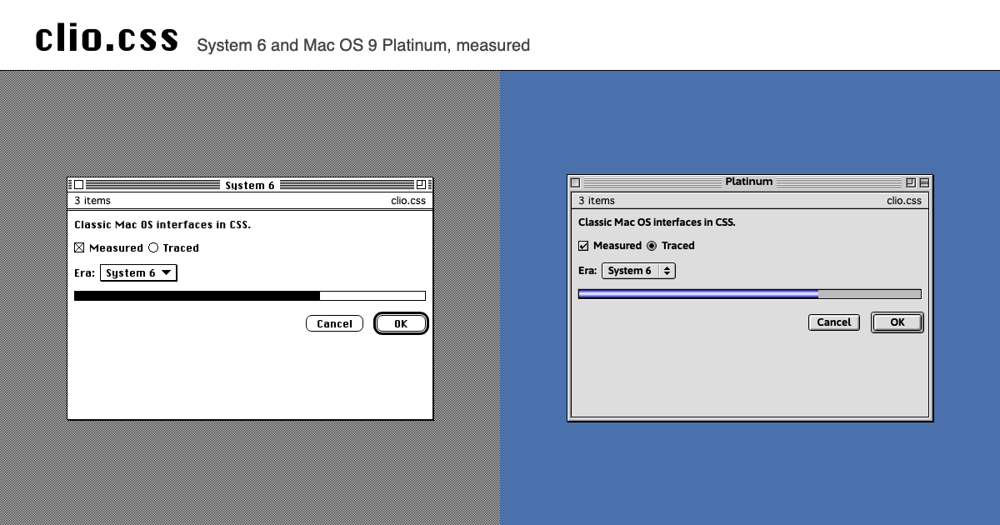

# clio.css

**A CSS library for classic Mac OS interfaces: Macintosh System 6, System 7, Mac OS 8.5 Drawing Board and Mac OS 8/9 Platinum.**
Windows, title bars, menu bars, push buttons, check boxes, radio buttons, text fields,
pop-up menus, list boxes, scroll bars, dialogs, group boxes, progress bars, tabs, the
Control Strip and desktop icons. Pure CSS, no JavaScript. MIT. No screenshots, icons, logos or Apple fonts.

Every value is traced to its source and labelled **measured** (read from real pixels of
the era), **inferred**, **adapted** (a deliberate web change) or **third-party**. System 6
and System 7 are measured from System 6.0.8 and 7.5.3 running in
[Infinite Mac](https://infinitemac.org), the screen read pixel for pixel; Drawing Board
(the appearance theme Apple shipped in the Mac OS 8.5 betas and withdrew) from Mac OS 8.5
with the theme installed, its control parts redrawn from the theme's own pixmaps; Platinum
from Mac OS 9.0 captures measured by [AI System 6](https://github.com/surfine/AI-System-6),
re-checked against Mac OS 9.0 running in Infinite Mac.



Docs and live examples: https://surfine.github.io/clio.css/

## Install

```bash
npm install clio.css
```

```html
<link rel="stylesheet" href="https://unpkg.com/clio.css@0.12.0/dist/clio.css">
```

| File | What it draws |
| --- | --- |
| `dist/clio.css` | System 6 by default; `data-era="system7"`, `data-era="drawingboard"` or `data-era="platinum"` on any element switches that subtree |
| `dist/clio.system6.css` | System 6 only (45 KB minified, 7 KB gzip) |
| `dist/clio.system7.css` | System 7 (colour) as the page default |
| `dist/clio.drawingboard.css` | Mac OS 8.5 Drawing Board as the page default |
| `dist/clio.platinum.css` | Platinum as the page default |
| `*.min.css` | Minified builds |
| `dist/components.json` | Machine-readable index: selectors, tokens, markup and evidence per component |

How it was measured, and what to reuse for the next era: [LESSONS.md](LESSONS.md). What is
still open: [ROADMAP.md](ROADMAP.md).

[COVERAGE.md](COVERAGE.md) checks clio.css against every control and window the classic
Apple guidelines define (1987, 1992, Inside Macintosh, Mac OS 8), era by era.

The stylesheets load fonts from `dist/fonts/` and the Drawing Board theme's pictures and
patterns from `dist/art/drawingboard/` with relative URLs, so serve the `dist` folder as a
whole (the CDNs above do).

Drawing Board draws its pencil lines with 128px patterns. Mac OS sometimes starts such a
pattern half a tile along, depending on where the window sits on screen; clio.css starts it
at the element, and `--clio-db-phase: 64px` on a window or control matches the other case.

## Quick start

```html
<html data-era="system7">  <!-- or "platinum"; omit for System 6 -->
<div class="window" style="width: 320px">
  <div class="title-bar">
    <button class="close" aria-label="Close"></button>
    <h1 class="title">Macintosh HD</h1>
    <button class="resize" aria-label="Zoom"></button>
    <button class="shade" aria-label="Collapse"></button> <!-- Platinum only -->
  </div>
  <div class="details-bar"><span>12 items</span><span>167K available</span></div>
  <div class="window-pane">
    <label><input type="checkbox" checked> Show warnings</label>
    <button class="default">OK</button>
  </div>
</div>
```

The Mac's arrow and I-beam cursors are on by default (redrawn from System 7.5.3 and
Mac OS 9.0, sharp at 2x and 3x); `class="clio-system-cursors"` on `<html>` brings the
system's back.

Form controls are styled on the native elements (`button`, `input`, `select`,
`textarea`, `fieldset`, `progress`), so keyboard, form and screen-reader behaviour stay
the browser's.

### clio.js (optional)

```html
<script src="https://unpkg.com/clio.css/dist/clio.js" defer></script>
```

A small script (no dependencies) for what a stylesheet cannot do. clio.css works without
it; with it:

- A pressed button, check box, radio button or title-bar box lets go while the pointer is
  off it, presses again on return, and does nothing if released outside, as the Mac's
  control tracking does.
- Return or Enter clicks a dialog's `.default` button and Esc or Cmd-. its cancel button
  (`data-clio-cancel` or `value="cancel"`), each after showing it pressed for 8 ticks.
- Menus track the pointer: press a title and drag, release on an item to choose it (it
  blinks three times first, as Mac OS 9 does), drag across titles to switch menus;
  submenus open after 9 ticks and stay while you head for them. Mac OS 8 and 9 keep a
  clicked menu open. From the keyboard the bar works as the web's application menu bar
  (one Tab stop, a title's menu previewed on focus, arrow keys, Home/End, Esc one level
  at a time, Tab out closes all); Command-key equivalents
  written as `<kbd>⌘N</kbd>` run their item on menu bars marked `data-clio-shortcuts`.
- `<select>` opens as the era's pop-up menu over the button, the current item on the
  button's row: drawn by the browser where `appearance: base-select` is supported (Chrome
  135, Safari 27) and the pointer is a mouse or trackpad, by clio.js in other browsers.
  Drawing Board's menus carry a pencil shade the browser's picker cannot, so clio.js draws
  those in every browser. Touch screens keep the system picker.
- Windows positioned `absolute` or `fixed` (or marked `data-clio-drag`) drag by the title
  bar as the Mac did: a grey outline follows the pointer and the window moves on release.
  Each movable window also gets a move button, out of sight until it has keyboard focus:
  arrow keys move the window 16px (Shift: 1px), Return opens a menu of moves, which a
  right click on the title bar opens too, and a polite live region says where it went.
  The collapse box folds a window to its title bar (`data-clio-shade="dblclick"` adds the
  double click). `clio.zoomRects(from, to)` draws the Finder's zoom rectangles.
- Text fields inside a `.window` get TextEdit's insertion point: a 1px line that inverts
  what is under it, a line tall, blinking every 34 ticks as measured in System 7.5.3 (lit
  and still under reduced motion). The browser's own caret comes back while text is
  selected or an input method is composing; `data-clio-caret="off"` keeps it everywhere.
- Centred labels (buttons, tabs, window titles) whose text would start on a half pixel get
  one more pixel at their end, so every engine lands on the Mac's `floor(spare / 2)`;
  measured when fonts load and on resize, never per frame (`data-clio-centre="off"`).
- Sounds: none ship. Set `clio.sounds.alert` (and `menu`, `collapse`, `expand`) to URLs
  and put `data-clio-sounds` on `<html>`; `clio.play(name)` plays one.
- Scroll areas (`.window-pane`, list boxes, `.clio-scroll`) get scroll bars drawn as
  elements with the same rules as the browser's: the scroll box keeps the era's fixed
  length, arrows repeat while held, a click in the lane pages, and System 6 and 7 drag an
  outline of the box while Mac OS 8 and 9 scroll live. `data-clio-scrolling="smart"`
  turns on Mac OS 8/9's Smart Scrolling (both arrows at the end, a proportional box).
  The scroller becomes `box-sizing: border-box` and gets a first child,
  `.clio-sb-anchor`; flex and grid scrollers, `textarea` and `select` keep the browser's
  bar. `data-clio-js="off"` on any element leaves it alone.

## Components

| Component | Markup |
| --- | --- |
| Window | `.window` › `.title-bar` (`.close`, `.title`, `.resize`, `.shade`) › `.details-bar` › `.window-pane`; `.window.inactive` |
| Menu bar and menus | `ul.menu-bar[role=menubar]` › `li` › `button[aria-expanded]` + `ul.menu[role=menu]`; `li[role=separator]`, `[aria-checked=true]`, `[aria-disabled=true]`, `kbd` |
| Push button | `button`, `.btn`; `.default` for the default ring; `.active` to pose pressed |
| Check box, radio button | `input[type=checkbox]`, `input[type=radio]` |
| Text field | `input[type=text]` and friends, `textarea` |
| Pop-up menu | `select`; `select[multiple]` becomes a list box |
| List box | `ul.listbox[role=listbox]` › `li[role=option][aria-selected]` |
| Scroll bar | automatic on `.window-pane`, `.listbox`, `textarea`; `.clio-scroll` on anything; `<html class="clio-scrollbars">` for the page |
| Dialogs and alerts | `.modal-dialog`, `.alert-box` (+ `.alert-icon.caution`), `.standard-dialog`, `.dialog-buttons` |
| Group box | `fieldset` + `legend` |
| Progress bar | `progress` |
| Tabs | `[role=tablist]` › `[role=tab][aria-selected]` + `[role=tabpanel]` |
| Desktop and icons | `.desktop`; `button.icon` › `img`/`svg` + `span` |

Coming from [system.css](https://github.com/sakofchit/system.css)? Its markup works
unchanged: `.title-bar button.close`, `button.resize`, `.inactive-title-bar`,
`.window-pane`, `.details-bar`, `.separator`, `.btn`, `.btn-default`, `.standard-dialog`,
`.modal-dialog`, `.alert-box`, `.outer-border`, `.inner-border`, `.field-row` and
`role="menu-bar"` / `role="menu-item"` menus.

## Customising

Every value is a `--clio-*` custom property, declared on `:root` and re-declared under
`[data-era="system7"]` and `[data-era="platinum"]`. Override any of them on any element. Every rule uses `:where()`
or a single class, so your own CSS always wins without `!important`.

```css
.my-app { --clio-selection-bg: #333399; --clio-button-radius: 4px; }
```

## How faithful is it?

[EVIDENCE.md](EVIDENCE.md) lists every value with its status and source: 57 of the 78
rows are **measured** from real pixels; 6 are still **inferred** and say so (one of them
for System 6).

[FIDELITY.md](FIDELITY.md) is a pixel check (`npm run fidelity`) against the real screens:

| Specimen | Pixels identical to the real screen |
| --- | ---: |
| System 6 check box (on and off), radio buttons, all four scroll arrows, grow box, progress fill, menu separator | 100% |
| System 6 pressed and hovered button | identical apart from the mouse pointer in the capture |
| System 6 default OK button | 99.7% |
| System 6 title bar, Finder info line, TeachText text | 100% |
| System 7 title bar, arrow boxes, grow box, alert frame, check boxes, radio buttons, pop-up menu, progress bar, menu separator | 99–100% |
| Platinum title bar | 94.3% |
| Platinum default OK button | 92.4% |

System 6 text is drawn in **Clio Sans '84** (Chicago 12) and **Clio Text '84** (Geneva 12
and 9), rebuilt pixel for pixel from the running system (about 3 KB each), so System 6
titles, menus, buttons and body text match the real screen exactly.
Platinum and Drawing Board chrome is drawn in **Clio Sans '97**, Charcoal 12 rebuilt the
same way from Mac OS 9.0 (3 KB), and at any other size in **Clio Sans '97 Display**
(`.display`), Charcoal's outlines traced from Mac OS 9.0 at 72 points; Asap stays as the
fallback. Window titles and push button labels use **Exact** variants whose antialiasing
levels take the very colours the real screen shows for clio.css's own title and button
colours (`@font-palette-values`); recolour them and set `--clio-font-window-title` or
`--clio-font-button` to a stack without "Exact".

Two Charcoal look-alikes can take over Platinum and Drawing Board chrome, set with an
attribute on `<html>` or any ancestor:
`data-clio-font="virtue"` uses [Virtue](https://www.scootergraphics.com/virtue/) by Marty P.
Pfeiffer, © [Scooter Graphics](https://www.scootergraphics.com/), a TrueType reworking of
Charcoal from 1997–99, which clio.css ships unchanged with the author's permission
(THIRD-PARTY.md); `data-clio-font="truth"` uses Truth FB (David Berlow's own expansion of
Charcoal, 2005, sold by Font Bureau), which you install or load yourself. Clio Sans '97
stays as the fallback. They are outline fonts drawn by the browser, not the measured pixels. `npm run capture:system6` re-takes the
System 6.0.8 reference frames from Infinite Mac; the frames are never committed.

What the era never had is adapted, not imitated: keyboard focus rings, touch-size
controls on `pointer: coarse` (title-bar boxes get a 45px hit area while their art stays
11px), solid grey instead of a dithered disabled state, and system controls in
forced-colours mode. The chasing arrows are the only animation, and they stop under
`prefers-reduced-motion`.

On Retina and other whole-number pixel ratios (2x, 3x) the art is magnified by nearest
neighbour, so every Mac pixel is a solid 2×2 or 3×3 block; at fractional ratios (1.25x,
1.5x, browser zoom) the browser's smoothing stays. `FIDELITY_DPR=2 npm run fidelity`
checks the specimens against the references magnified the same way: 103 of 110 are
identical at 2x and 100 at 3x. The rest are parts the layout puts on a half pixel (centred
text with an odd spare width, controls aligned to a line's middle), which the browser
rounds away at 1x and draws one device pixel over at 2x and 3x.

## Browser support

Current Chrome, Edge, Safari and Firefox. Uses `:where()`, `:has()` and custom
properties. Scroll-bar parts (arrows, scroll box) draw in Chromium and Safari; Firefox
gets the era's scroll-bar colours only.

## How it compares

| Library | Look | Licence |
| --- | --- | --- |
| [98.css](https://github.com/jdan/98.css) | Windows 98 | MIT |
| [7.css](https://github.com/khang-nd/7.css) | Windows 7 | MIT |
| [XP.css](https://github.com/botoxparty/XP.css) | Windows XP | MIT |
| [system.css](https://github.com/sakofchit/system.css) | Classic Apple (System 6 style) | MIT |
| [Puppertino](https://github.com/codedgar/Puppertino) | Modern macOS / iOS | MIT |
| **clio.css** | System 6, System 7, Mac OS 8.5 Drawing Board and Mac OS 8/9 Platinum, with per-value evidence | MIT |

## For AI agents

- [`llms.txt`](llms.txt) — summary and links ([llmstxt.org](https://llmstxt.org) format)
- [`llms-full.txt`](https://surfine.github.io/clio.css/llms-full.txt) — every component's markup and the full stylesheet
- [`components.json`](https://surfine.github.io/clio.css/components.json) — selectors, tokens, HTML and evidence per component
- [`AGENTS.md`](AGENTS.md) — how to use and change this repository

## Develop

```bash
npm run build      # dist/, docs/, llms.txt, EVIDENCE.md from src/ and components/index.mjs
npm test           # build + static checks
npm run fidelity   # pixel check against AI System 6's references (needs a local checkout)
```

## Licence

MIT, see [LICENSE](LICENSE). Bundled fonts and art are described in
[THIRD-PARTY.md](THIRD-PARTY.md): Clio Sans '84, Clio Text '84 and Clio Sans '97 (pixel reconstructions
of Chicago and Geneva, shipped under MIT; read the note there), ChicagoFLF (public domain), Asap (SIL OFL 1.1),
and SVG art from system.css (MIT).

clio.css is not affiliated with or endorsed by Apple Inc. Macintosh, Mac OS, Chicago,
Geneva and Charcoal are trademarks of Apple Inc., named only to describe the eras
recreated.
