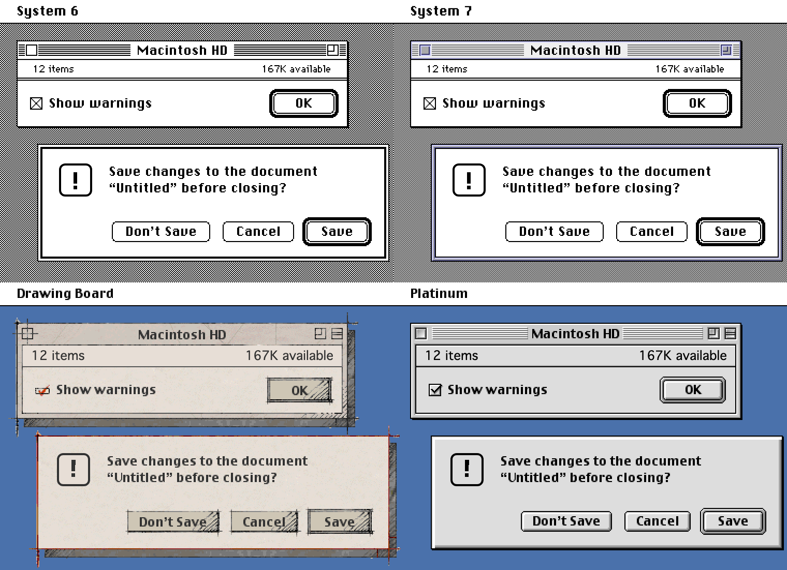

# clio.css

**Classic Mac OS and NeXTSTEP in CSS.** Windows, menus, controls and dialogs of System 6,
System 7, Mac OS 8.5 Drawing Board, Mac OS 9 Platinum and NeXTSTEP 3.3, drawn on native HTML
elements, with every value traced to a source and labelled measured, inferred, adapted or
third-party.

[](https://www.npmjs.com/package/clio.css)
[](LICENSE)
[](#install)
[](package.json)



The same markup in five eras, rendered by clio.css in Chromium
([`tooling/readme-eras.ts`](tooling/readme-eras.ts); 1x: [`assets/eras.png`](assets/eras.png)).
Docs and live examples: https://surfine.github.io/clio.css/

## Install

Four ways in, from least to most code:

```html
<!-- 1. One CSS file: the four Classic eras, System 6 by default -->
<link rel="stylesheet" href="https://unpkg.com/clio.css@2.0.2/dist/clio.css">
<!-- NeXTSTEP is its own file: https://unpkg.com/clio.css@2.0.2/dist/clio.nextstep.css -->
<!-- optional behaviour (menus, scroll bars, window dragging): -->
<script src="https://unpkg.com/clio.css@2.0.2/dist/clio.js" defer></script>
```

```js
// 2. ES modules with a bundler (Vite, esbuild, …), after npm install clio.css
import "clio.css";                         // or "clio.css/nextstep", "clio.css/platinum", …
import { install } from "clio.css/js.esm";
install();                                 // importing alone installs nothing
```

```tsx
// 3. Preact: npm install clio.css clio.css-preact preact
// 4. React:  npm install clio.css clio.css-react react
import { Window, Button, FieldRow } from "clio.css-react";   // or "clio.css-preact"

export const App = () => (
  <Window title="Macintosh HD" style={{ width: "300px" }}>
    <FieldRow><Button>Cancel</Button><Button default>OK</Button></FieldRow>
  </Window>
);
```

Set `data-era` (`system6`, `system7`, `drawingboard`, `platinum`) on `<html>` or any
element; the components render exactly the markup documented on the site, and the look comes
from the stylesheet. The jsDelivr URL works the same way
(`https://cdn.jsdelivr.net/npm/clio.css@2.0.2/dist/clio.css`).

| File | Draws | Minified | gzip |
| --- | --- | ---: | ---: |
| `dist/clio.css` | The four Classic eras; System 6 by default, `data-era` switches any subtree | 223 kB | 36.7 kB |
| `dist/clio.system6.css` | System 6 only | 98.8 kB | 17.7 kB |
| `dist/clio.system7.css` | System 7 (colour) as the page default | 113 kB | 20.2 kB |
| `dist/clio.drawingboard.css` | Drawing Board as the page default | 191 kB | 33.3 kB |
| `dist/clio.platinum.css` | Platinum as the page default | 152 kB | 27.1 kB |
| `dist/clio.nextstep.css` | NeXTSTEP 3.3 (its own file, never in `clio.css`) | 154 kB | 26.2 kB |

Sizes are the `*.min.css` builds of this version (gzip level 9); fonts and art load
separately, by relative URL from `dist/fonts/` and `dist/art/`, so serve the `dist` folder
whole (the CDNs do). `dist/components.json` is the machine-readable index: selectors, tokens,
markup and evidence for each component.

## How it differs

| Library | Era | Technology | Licence | Last activity seen | Values traced to sources |
| --- | --- | --- | --- | --- | --- |
| clio.css | System 6, System 7, Mac OS 8.5 Drawing Board, Mac OS 9 Platinum, NeXTSTEP 3.3 | CSS, optional JS, Preact and React components | MIT | 2.0.0, 2026-11-26 | A row per value in [EVIDENCE.md](EVIDENCE.md); pixel check in [FIDELITY.md](FIDELITY.md) |
| [system.css](https://github.com/sakofchit/system.css) | System 6 | CSS | MIT | 2023-03-18 | Not stated |
| [New Dawn](https://github.com/npjg/new-dawn) (classic.css) | Mac OS 8.1 | CSS | Not found | 2019-06-20 | Not stated |
| [Classicy](https://github.com/robbiebyrd/classicy) | Mac OS 8 (and a System 7 appearance) | React | Unlicense | 2026-11-23 | Not stated |
| [platinum.css](https://github.com/mat-sz/platinum.css) | Mac OS 9 (README: not ready for use) | SCSS | BSD-3-Clause-Clear (npm) | 2020-06-30 | Not stated |
| [98.css](https://github.com/jdan/98.css), the genre's reference | Windows 98 | CSS | MIT | 2025-09-07 | Not stated |

No NeXTSTEP CSS library was found (searched 2026-11-27). "Not stated" means no per-value
evidence was found in the project's README or repository root, not that none exists; dates
are the newest commit or publish seen on 2026-11-27, on each project's GitHub page and npm.

**The gap clio.css fills:** one library for Classic Mac OS from System 6 to Mac OS 9 plus
NeXTSTEP, where each value says where it came from and the pixel check can be re-run.

- **Measured, and labelled.** Every value has a row in [EVIDENCE.md](EVIDENCE.md) with a
  source and a status: 255 of 348 rows are **measured** from real pixels of the era, 44
  **inferred**, 45 **adapted** for the web and 4 **third-party**. Inferred rows say so.
- **Native elements, accessible by default.** Controls are styled on `button`, `input`,
  `select`, `textarea`, `fieldset` and `progress`, so keyboard, forms and screen readers
  keep the browser's behaviour. Focus rings, forced-colours mode and a 45px touch hit area
  on title-bar boxes are [labelled adaptations](#what-the-era-did-not-have).
- **Overridable.** Every rule uses `:where()` or a single class, and every value is a
  `--clio-*` custom property, so your CSS wins without `!important` ([Theming](#theming)).
- **Checkable.** The claims above can be checked rather than taken on trust: read the
  evidence rows, and run `npm run fidelity:public` ([Fidelity](#fidelity)).

## Quick start

```html
<!doctype html>
<html lang="en" data-era="system7"> <!-- system6 (default), system7, drawingboard or platinum -->
<head>
  <meta charset="utf-8">
  <link rel="stylesheet" href="https://unpkg.com/clio.css@2.0.2/dist/clio.css">
</head>
<body>
  <div class="window" style="width: 320px">
    <div class="title-bar">
      <button class="close" aria-label="Close"></button>
      <h1 class="title">Macintosh HD</h1>
      <button class="resize" aria-label="Zoom"></button>
      <button class="shade" aria-label="Collapse"></button> <!-- drawn in Drawing Board and Platinum -->
    </div>
    <div class="details-bar"><span>12 items</span><span>167K available</span></div>
    <div class="window-pane">
      <label><input type="checkbox" checked> Show warnings</label>
      <button class="default">OK</button>
    </div>
  </div>
</body>
</html>
```

`data-era` works on `<html>` or on any element, so one page can show several eras. The
Mac's arrow and I-beam cursors are on by default; `class="clio-system-cursors"` on
`<html>` brings back the system's.

## Eras

| `data-era` | Measured from | What you see |
| --- | --- | --- |
| `system6` (default) | System 6.0.8 in [Infinite Mac](https://infinitemac.org) | 1-bit black and white, striped title bars, dithered desktop |
| `system7` | System 7.5.3 in Infinite Mac | Colour frame and title bar on the System 6 layout |
| `drawingboard` | Mac OS 8.5 with the 8.5b6 Drawing Board theme, in Infinite Mac; control parts from the theme's own pixmaps | Paper, pencil lines and hatched corners (the Appearance theme Apple shipped in betas and withdrew) |
| `platinum` | Mac OS 9.0 in Infinite Mac, and GUIdebook Mac OS 9.0 captures | Grey bevelled controls, ridged title bars, the WindowShade box |
| `nextstep` (`dist/clio.nextstep.css`) | NeXTStep 3.0 in Infinite Mac (the nearest real 3.x system it runs), for NeXTSTEP 3.3's look | Four greys, black key title bars, the vertical main menu, scrollers on the left with their arrows together |

Drawing Board draws its pencil lines with 128px patterns. Mac OS sometimes starts such a
pattern half a tile along, depending on where the window sits; clio.css starts it at the
element, and `--clio-db-phase: 64px` on a window or control matches the other case.

### NeXTSTEP 3.3

`dist/clio.nextstep.css` draws NeXTSTEP 3.3 on the same markup: the menu bar becomes the
vertical main menu (titled by its `aria-label`, submenus hanging level with its top), the
collapse box becomes the miniaturize button, the close box moves to the right, and a window
with a zoom box gets the resize bar instead (NeXT had no zoom). With clio.js the main menu is a column for the keyboard as well
(Up and Down between titles, Right into a submenu), and NeXT's own arrow and I-beam cursors
replace the Mac's. `data-clio-depth="2bit"` gives a black-and-white NeXT's workspace. `.window.main` is a main
window that is not key. Three components exist only there: `.browser` (the column browser),
`.pull-down` and `.dock`. With clio.js the scrollers sit on the left with both arrows
together, as measured; without it the browser keeps its own bar on the right. Helvetica is
named locally; elsewhere Clio Sans NX (Liberation Sans 2, OFL, renamed) is fitted to NeXT's
screen font: whole-pixel advances and no kerning, within 0.6px of NeXT's label widths.
NeXTSTEP never enters `clio.css`.

## Components

32 entries, the same as `dist/components.json`. Each name links to its docs section with
markup, tokens and evidence; the selectors are the first ones listed in the JSON.

| Component | Selectors |
| --- | --- |
| [Window](https://surfine.github.io/clio.css/#window) | `.window`, `.window.inactive`, `.title-bar`, `.title-bar > .title` |
| [Menu bar and menus](https://surfine.github.io/clio.css/#menu) | `.menu-bar`, `[role=menubar]`, `.menu`, `[role=menu]` |
| [Push button](https://surfine.github.io/clio.css/#button) | `button`, `.btn`, `.default`, `.btn-default` |
| [Check box](https://surfine.github.io/clio.css/#checkbox) | `input[type=checkbox]`, `label > input[type=checkbox]`, `.field-row` |
| [Radio button](https://surfine.github.io/clio.css/#radio) | `input[type=radio]` |
| [Text field](https://surfine.github.io/clio.css/#text-field) | `input[type=text]`, `input[type=search]`, `input[type=email]`, `input[type=password]` |
| [Pop-up menu](https://surfine.github.io/clio.css/#select) | `select`, `select[multiple]`, `select[size]` |
| [List box](https://surfine.github.io/clio.css/#listbox) | `.listbox`, `[role=listbox]`, `[role=option]`, `[aria-selected=true]` |
| [Scroll bar](https://surfine.github.io/clio.css/#scrollbar) | `.window-pane`, `.clio-scroll`, `html.clio-scrollbars`, `::-webkit-scrollbar` |
| [Dialogs and alerts](https://surfine.github.io/clio.css/#dialog) | `.modal-dialog`, `.alert-box`, `.standard-dialog`, `.modeless-dialog` |
| [Group box](https://surfine.github.io/clio.css/#fieldset) | `fieldset`, `legend` |
| [Progress bar](https://surfine.github.io/clio.css/#progress) | `progress` |
| [Tabs](https://surfine.github.io/clio.css/#tabs) | `[role=tablist]`, `[role=tab]`, `[aria-selected=true]`, `[role=tabpanel]` |
| [Control Strip](https://surfine.github.io/clio.css/#control-strip) | `.control-strip`, `.control-strip.is-collapsed`, `.control-strip-scroll`, `.control-strip-scroll-back` |
| [Desktop and icons](https://surfine.github.io/clio.css/#desktop) | `.desktop`, `.icon`, `.icon > img`, `.icon > figcaption` |
| [Disclosure triangle](https://surfine.github.io/clio.css/#disclosure) | `.disclosure`, `.disclosure[aria-expanded=true]`, `details > summary`, `details[open] > summary` |
| [List view](https://surfine.github.io/clio.css/#list-view) | `.list-view`, `.list-view th[aria-sort]`, `.list-view th.sort-direction`, `.list-view td.sorted` |
| [Slider](https://surfine.github.io/clio.css/#slider) | `input[type=range]`, `input[type=range].ticks` |
| [Little arrows](https://surfine.github.io/clio.css/#little-arrows) | `.little-arrows`, `.little-arrows > .up`, `.little-arrows > .down`, `.little-arrows[aria-disabled=true]` |
| [Bevel button](https://surfine.github.io/clio.css/#bevel-button) | `.bevel`, `.bevel.menu`, `.bevel[aria-pressed=true]`, `.bevel:active` |
| [Chasing arrows](https://surfine.github.io/clio.css/#chasing-arrows) | `.chasing-arrows` |
| [Help button](https://surfine.github.io/clio.css/#help-button) | `.help-button` |
| [Image well](https://surfine.github.io/clio.css/#image-well) | `.image-well` |
| [Help balloon](https://surfine.github.io/clio.css/#balloon) | `.balloon` |
| [Rounded-corner window](https://surfine.github.io/clio.css/#rounded-window) | `.rounded-window`, `.rounded-window.inactive`, `.rounded-title`, `.rounded-title > .close` |
| [Side-title utility window](https://surfine.github.io/clio.css/#side-utility-window) | `.window.utility.side`, `.window.utility.side.inactive` |
| [Placard](https://surfine.github.io/clio.css/#placard) | `.placard`, `.placard[aria-disabled=true]` |
| [Split bar](https://surfine.github.io/clio.css/#split-bar) | `.split-view`, `.split-bar`, `.split-line` |
| [Browser (NeXTSTEP)](https://surfine.github.io/clio.css/#browser) | `.browser`, `.browser > .listbox`, `.browser .branch` |
| [Pull-down list (NeXTSTEP)](https://surfine.github.io/clio.css/#pull-down) | `.pull-down` |
| [Workspace dock (NeXTSTEP)](https://surfine.github.io/clio.css/#dock) | `.dock`, `.dock > li`, `.dock > .not-running` |
| [Type and tokens](https://surfine.github.io/clio.css/#typography) | `.clio`, `.text`, `.heading`, `.display` |

Where an era never had a control (tabs or sliders in System 6, for example), it borrows a
later era's so a page keeps working when it switches era; [dev/COVERAGE.md](dev/COVERAGE.md)
checks every control and window in Apple's 1987, 1992 and Mac OS 8 guidelines, era by era.

**Coming from [system.css](https://github.com/sakofchit/system.css)?** Its markup works
unchanged: `.title-bar button.close`, `button.resize`, `.inactive-title-bar`,
`.window-pane`, `.details-bar`, `.separator`, `.btn`, `.btn-default`, `.standard-dialog`,
`.modal-dialog`, `.alert-box`, `.outer-border`, `.inner-border`, `.field-row` and
`role="menu-bar"` / `role="menu-item"` menus.

## clio.js (optional)

```html
<script src="https://unpkg.com/clio.css@2.0.2/dist/clio.js" defer></script>
```

No dependencies; 72.4 kB, or 48.0 kB as `dist/clio.min.js`. clio.css works without it.
As a module: `import { install } from "clio.css/js.esm"; install();` (importing alone
installs nothing; `api` is the same object as `window.clio`).
With it:

- Buttons, check boxes, radio buttons and title-bar boxes track the pointer as the Mac's
  controls did; Return clicks a dialog's `.default` button, Esc or Cmd-. its cancel button.
- Menus track a press-and-drag, open submenus, and work from the keyboard as an
  application menu bar.
- `<select>` opens as the era's pop-up menu (touch screens keep the system picker).
- Scroll areas get the era's scroll bars as elements.
- Windows positioned `absolute` or `fixed` drag by the title bar, with a keyboard
  alternative; the collapse box folds a window to its title bar.
- Text fields in a `.window` get TextEdit's blinking insertion point.
- Optional interface sounds, from packs you build yourself.

Types for `window.clio` ship as `dist/clio.d.ts`. `data-clio-js="off"` on any element
leaves it alone.

<details>
<summary>Details: controls, menus, pop-ups, windows, caret, centring, scroll bars</summary>

- A pressed control lets go while the pointer is off it, presses again on return, and does
  nothing if released outside. A dialog's default or cancel button shows pressed for 8
  ticks before it fires; the cancel button is `data-clio-cancel` or `value="cancel"`.
- Menus: release on an item to choose it (it blinks three times first, as Mac OS 9 does),
  drag across titles to switch menus; submenus open after 9 ticks and stay while you head
  for them. Mac OS 8 and 9 keep a clicked menu open. From the keyboard the bar is one Tab
  stop, a title's menu previews on focus, arrow keys, Home/End and Esc work one level at a
  time, and Tab out closes all. Command-key equivalents written as `<kbd>⌘N</kbd>` run
  their item on menu bars marked `data-clio-shortcuts`.
- `<select>` is drawn by the browser where `appearance: base-select` is supported
  (Chrome 135, Safari 27) and the pointer is a mouse or trackpad, by clio.js elsewhere.
  Drawing Board's pop-ups carry a pencil shade the browser's picker cannot, so clio.js
  draws those in every browser.
- Window dragging shows the era's grey outline and moves the window on release (mark any
  other window `data-clio-drag`). Each movable window gets a move button, hidden until it
  has keyboard focus: arrow keys move it 16px (Shift: 1px), Return opens a menu of moves
  (a right click on the title bar opens it too), and a polite live region says where it
  went. `data-clio-shade="dblclick"` adds collapse on double click.
  `clio.zoomRects(from, to)` draws the Finder's zoom rectangles.
- The insertion point is a 1px line that inverts what is under it, blinking at the era's
  rate (32 ticks in System 6 and 7, 48 in Mac OS 8 and 9; lit and still under reduced
  motion). The browser's caret returns while text is selected or an input method is
  composing; `data-clio-caret="off"` keeps it everywhere.
- Centred labels whose text would start on a half pixel get one more pixel at their end,
  so every engine lands on the Mac's `floor(spare / 2)`; measured when fonts load and on
  resize, never per frame (`data-clio-centre="off"`).
- Scroll bars keep the era's fixed scroll-box length, repeat while an arrow is held and
  page on a click in the lane; System 6 and 7 drag an outline of the box, Mac OS 8 and 9
  scroll live. `data-clio-scrolling="smart"` turns on Smart Scrolling. The scroller becomes
  `box-sizing: border-box` and gets a first child, `.clio-sb-anchor`; flex and grid
  scrollers, `textarea` and `select` keep the browser's bar.

</details>

<details>
<summary>Sounds</summary>

None ship: the sounds belong to Apple and to the sets' authors. Build a pack from your own
copies of the Mac OS 8.5–9 Appearance sound sets and System alert sounds with
`npm run soundset` (`tooling/soundset.py`, into the git-ignored `packs/`), serve it, then:

```js
await clio.sounds.use("packs/sets/platinum-sounds/manifest.json");
await clio.sounds.use("packs/alerts/platinum/manifest.json");
```

A sound set plays for Drawing Board and Platinum (`{ era }` to choose; System 6 and 7 had
no interface sounds), an alert list for its own eras. `clio.play("alert")` plays the era's
alert sound. `data-clio-sounds="menus windows controls finder"` keeps those classes
(`"none"`: silent), `clio.sounds.muted = true` silences the page, a hidden page is silent,
and each sound fires a `clio:sound` event. `dist/clio-sounds-panel.js` draws Appearance >
Sound's controls for a site: `clioSoundsPanel(element, { base: "https://…/packs/" })`.
What was measured and what is inferred: the sound rows in [EVIDENCE.md](EVIDENCE.md); the pack
format is described at the top of `tooling/soundset.py`.

</details>

## Contract and tokens

`clio.css/contract` is what a host checks itself against: the eras, each component's
selectors, aliases and tokens, and each era's page-default token values, typed to the
token names. `clio.css/tokens/<era>.json` has the values alone.

```js
import contract from "clio.css/contract";
contract.tokens.nextstep["--clio-titlebar-height"];   // "22px"
```

## Preact and React

```bash
npm install clio.css clio.css-preact   # or clio.css-react
```

The 32 components are written once in JSX (`packages/components`) and published as
[`clio.css-preact`](packages/preact/README.md) and [`clio.css-react`](packages/react/README.md),
same version as clio.css. Each renders exactly the markup documented here, checked in both
frameworks by `npm test` and, from the packed tarballs, by `npm run verify`. They are
controlled components with no behaviour of their own: load clio.css beside them, and clio.js
for behaviour.

## Theming

Tokens are declared on `:root` (System 6) and re-declared under `[data-era="system7"]`,
`[data-era="platinum"]` and `[data-era="drawingboard"]` (Drawing Board shares Platinum's
block, then overrides it). Override any of them on any element:

```css
.my-app {
  --clio-selection-bg: #333399;
  --clio-button-radius: 4px;
}
```

The full list is in the docs under [Type and tokens](https://surfine.github.io/clio.css/#typography)
and in each component's `tokens` in `dist/components.json`.

### Chinese, Japanese and Korean

Set `lang` (`zh-Hant`/`zh-TW`, `zh-Hans`/`zh`, `ja`, `ko`) on `<html>` or any element and
the chrome and text take that language's fonts: the period bitmap font if installed
(Taipei, Beijing, Osaka, Seoul), then Fusion Pixel 12px cut to that font's character set
(Big5 93.7%, GB 2312 99.1%, JIS X 0208 99.5%, KS X 1001 97.4% covered), then the period
outline family. Each language's file (176–322 kB) loads only for text in that language.
Rows, line heights and baselines do not change: KanjiTalk 7.5.3 and Mac OS 9.0 with the
Chinese Language Kits draw CJK at the Roman geometry. Override the stack with
`--clio-font-cjk`.

## Fonts

clio.css ships no Apple font files. The Clio fonts are pixel reconstructions, read glyph
by glyph from the running systems and built as new font files; the letterforms are
Apple's, which is why the fonts have other names. Licences and the legal note:
[THIRD-PARTY.md](THIRD-PARTY.md#fonts).

| Font | What it is | Used for | Licence |
| --- | --- | --- | --- |
| Clio Sans '84 | Chicago 12, from System 6.0.8 | System 6 and 7 chrome | MIT (clio.css) |
| Clio Text '84 (12 and 9) | Geneva 12 and 9, from System 6.0.8 | System 6 and 7 text | MIT (clio.css) |
| Clio Sans '97 (+ Title, Exact, Display) | Charcoal 12 from Mac OS 9.0; Display traced from Charcoal at 72 points | Drawing Board and Platinum chrome | MIT (clio.css) |
| Virtue 3.2.1 | Marty P. Pfeiffer's reworking of Charcoal, © [Scooter Graphics](https://www.scootergraphics.com/) | `data-clio-font="virtue"` | Shipped unchanged by the author's permission, for clio.css only |
| Fusion Pixel Font 12px | TakWolf's pixel font, cut per language | CJK stand-in | SIL OFL 1.1 |
| ChicagoFLF | Robin Casady's outline revival of Chicago | System 6 and 7 `.display` text | Public domain |
| Asap | Omnibus-Type's outline sans | Platinum and Drawing Board fallback | SIL OFL 1.1 |
| Clio Sans NX | Liberation Sans 2 (Red Hat), subset and renamed | NeXTSTEP fallback for Helvetica | SIL OFL 1.1 |

If Charcoal is installed, the Drawing Board and Platinum stacks use it first.
`data-clio-font="truth"` uses Truth FB, which you install or load yourself. Window titles
and button labels use the **Exact** variants, whose antialiasing levels take the colours
the real screen shows; if you recolour them, set `--clio-font-window-title` or
`--clio-font-button` to a stack without "Exact".

## Fidelity

`npm run fidelity` renders specimens in Chromium at 1x and compares them pixel by pixel
with captures of each era. From [FIDELITY.md](FIDELITY.md) (run of 2026-11-26):

| Era | Reference | Specimens at 100.0% same |
| --- | --- | ---: |
| System 6 | System 6.0.8 in Infinite Mac (1-bit) | 23 of 23 |
| System 7 | System 7.5.3 in Infinite Mac | 26 of 26 |
| Drawing Board | Mac OS 8.5 + 8.5b6 theme in Infinite Mac | 52 of 54 |
| Platinum | Mac OS 9.0 in Infinite Mac | 55 of 55 |
| Platinum | GUIdebook Mac OS 9.0 captures | 7 of 7 |
| NeXTSTEP | NeXTStep 3.0 in Infinite Mac | 40 of 40 |

The two Drawing Board specimens below 100% are the open pop-up menu (97.3%), whose text is
antialiased over the paper. NeXTSTEP is measured on 3.0 because Infinite Mac runs no 3.3. The
same file has the WebKit, Firefox, 2x and 3x results (210 specimens compared). Its five
`nx-ais6-*` rows compare with AI System 6's own drawn tiles, a check of agreement rather than
fidelity, and are left out above. The three CJK specimens were not compared in that run: their
frames were not on the machine that ran it.

**What you can check yourself, and what only the author can.** The captures are Apple's
pixels, so they are not in this repository. What is committed instead is
[`test/fidelity-digests.json`](test/fidelity-digests.json): for each specimen, the SHA-256 of
its reference crop (thresholded to 1-bit where the comparison is, masked pixels left out).
204 of 213 specimens are publicly checkable:

```bash
git clone https://github.com/surfine/clio.css && cd clio.css
npm ci && npx playwright install chromium
npm run fidelity:public    # renders each specimen and compares it with its digest
```

A digest proves "identical" or "not identical", nothing in between, so it covers only the
specimens the full run found 100% identical. The 9 it cannot cover, each with its reason in the
digest file: the two Drawing Board pop-up menus (97.3%), three CJK specimens whose frames
were not on the machine that wrote the digests, and the four `nx-ais6-*` specimens, which
compare with AI System 6's own drawn tiles (agreement, not fidelity). The percentages, the
diff images, the 2x/3x runs and the reference captures themselves need `npm run fidelity` and
the author's private AI System 6 checkout.

At whole-number pixel ratios (2x, 3x) the art is magnified by nearest neighbour, so every
Mac pixel becomes a solid block; at fractional ratios the browser's smoothing stays.

### What the era did not have

What the era never had is adapted, not imitated, and labelled **adapted** in EVIDENCE.md:
keyboard focus rings, larger controls on `pointer: coarse` (title-bar boxes get a 45px hit
area while their art stays 11px), solid grey instead of a dithered disabled state, and
system controls in forced-colours mode. The chasing arrows, menu blinks, zoom rectangles
and caret blink honour `prefers-reduced-motion`.

## Versions and support

**Only 2.x is maintained** (since 2026-11-27). 2.0 has 1.1.1's CSS rules unchanged (checked
by `npm run verify` against the 1.1.1 tarball), so moving from 1.x renders the same; 1.x,
declared the Classic long-term line on 2026-11-18, gets no further releases. 2.x is supported
for at least 12 months from 2.0.1.

Within 2.x these stay compatible: the selectors and aliases in `components.json`; every
`--clio-*` name and its meaning (its value may change when a measurement corrects it, recorded
in the CHANGELOG with its evidence row); each component's markup; the `dist/` file paths and
`exports` keys, whose rules change only as recorded fixes; the shape of `clio.css/contract`
and `clio.css/tokens/<era>.json`; and the keys and types of `window.clio`. Not promised:
values a better measurement corrects, clio.js's internals, the docs site and tooling.
The component packages promise the DOM they render (it is `components.json`'s markup) and
otherwise follow semver only: their component names and props may change in a minor version,
with a CHANGELOG note. Every value that is not a plain measurement is labelled inferred or
adapted in [EVIDENCE.md](EVIDENCE.md), with its reason.

## Browser support

Current Chrome, Edge, Safari and Firefox. Uses `:where()`, `:has()` and custom properties.
Scroll-bar parts drawn by the stylesheet need `::-webkit-scrollbar` (Chromium and Safari);
Firefox gets the era's colours only, or full scroll bars with clio.js.

## For AI agents

- [`llms.txt`](llms.txt): summary and links ([llmstxt.org](https://llmstxt.org) format)
- [`llms-full.txt`](https://surfine.github.io/clio.css/llms-full.txt): every component's markup and the full stylesheet
- [`components.json`](https://surfine.github.io/clio.css/components.json): selectors, tokens, HTML and evidence per component
- [`AGENTS.md`](AGENTS.md): how to use and change this repository

## Contributing

```bash
npm install
npm run build      # dist/, docs/, llms.txt, EVIDENCE.md from packages/core/src
npm test           # build + static checks
npm run fidelity:public   # pixel check against the committed digests
npm run verify     # the release gate: fresh clone, packs, baselines, docs, links
npm run fidelity   # full pixel check (needs the author's AI System 6 checkout)
```

Commits made with AI tools say so in an `Assisted-by:` trailer, the form Fedora's AI policy uses.
Every new or changed value needs an evidence row with an honest status; see
[AGENTS.md](AGENTS.md). Scope is fixed: Classic Mac OS and NeXTSTEP, no new eras (Mac OS X is a
separate project, clio.wasm). How the eras were measured: [dev/LESSONS.md](dev/LESSONS.md).
`node tooling/readme-eras.ts` re-renders the README image.

## Licence

MIT, see [LICENSE](LICENSE). Bundled fonts and art, and their licences, are listed in
[THIRD-PARTY.md](THIRD-PARTY.md).

clio.css is not affiliated with or endorsed by Apple Inc. Macintosh, Mac OS, Chicago,
Geneva and Charcoal are trademarks of Apple Inc., named only to describe the eras
recreated.
